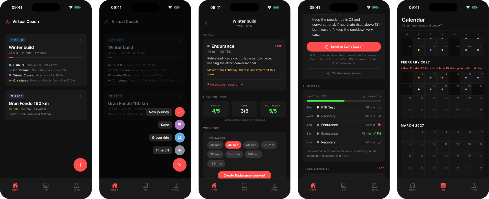
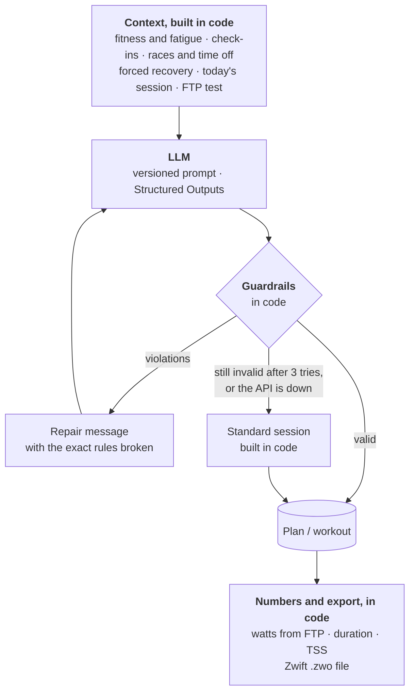

# Virtual Coach

A cycling coach for my winters on Zwift. It reads my rides from Strava, keeps track of fitness
and fatigue, and lets a language model plan the weeks up to a race and write the workout for
each day. The workout ends up as a file Zwift can load.



`Python 3.12` · `FastAPI` · `SQLite` · `OpenAI Structured Outputs` · `React Native / Expo` · `Strava API` · `Docker`

## Why this repo is interesting

Getting an LLM to write a training plan is easy. Getting one you can actually ride is
harder. A plan can read perfectly well and still be wrong: the days of a week add up to far
more load than the week was meant to have, hard sessions sit back to back, or the taper is no
easier than the weeks before it. Nothing in the text gives that away. Even in the last eval
run, one of the model's answers for the race plan failed the checks and had to be repaired.

So most of the work went into everything around the model. It writes the parts that need
judgment, like how a plan is structured and what a session looks like. Everything that can
be computed or checked is done in plain code, and nothing the model returns is used before
that code has checked it.

## How the AI works



Before the model is called at all, code has already decided a lot. It works out fitness and
fatigue from the ride history, reads the latest check-in and picks the session for today. If
the legs are sore, the form is deep in the negative or the load has jumped, it decides on
recovery, and the model is told so instead of being asked. FTP tests are placed and built in
code too, because a test only means something if it is the same protocol every time.

The model then answers through
[Structured Outputs](https://platform.openai.com/docs/guides/structured-outputs) into Pydantic
schemas ([`schemas.py`](backend/logic/schemas.py)), so there is no text to parse. What comes
back is checked by [`guardrails.py`](backend/logic/guardrails.py): how fast the load ramps up
from week to week, recovery weeks, the taper, rest days, whether a day's TSS is physically
possible, the easy days around a race, days off, the slots for FTP tests, and for workouts
the length, the power you can sustain and heart-rate caps. When something breaks a rule, the
model gets the exact list back ("Week 5: days sum to 455 TSS but the target is 305") and
tries again, up to three times ([`ai.py`](backend/logic/ai.py)). An answer that was cut off
at the output limit is reported as exactly that, so the model shortens it rather than
guessing what went wrong.

If the third attempt fails too, or OpenAI is unreachable, the day still gets a workout:
[`fallback.py`](backend/logic/fallback.py) builds a standard session of the planned type,
say 3 x 10 minutes of sweet spot, fitted to the time available and checked by the same
guardrails. The app labels it as a standard session and offers to ask the coach again. A
plan rebuild that fails keeps the old plan.

The model also never produces a number that can be calculated. It describes a workout in
percent of FTP, and [`workout_math.py`](backend/logic/workout_math.py) turns that into watts,
duration, TSS and the Zwift XML. That way the TSS shown in the app is always the TSS of the
file you ride.

Plans are generated in two steps ([`ai_planner.py`](backend/logic/ai_planner.py)): one call
for the shape of the whole plan, week by week, then the days in blocks of four weeks against
those targets. A 16-week plan in one answer runs into the output limit, and a block of four
weeks is small enough to check and repair on its own. When I add a race to a running plan,
only the weeks from next Monday on are planned again.

A few smaller things that matter once you rely on it:

- The OpenAI client has a timeout and retries with backoff ([`llm.py`](backend/core/llm.py)),
  and every athlete has a daily call budget. Workouts are cached per day and duration, so
  opening the app twice costs nothing.
- Prompts are plain files in [`prompts/`](backend/prompts). Their version is the file name plus
  a hash of the content, and it is stored with every call and every eval report.
- What the athlete types, like the goal or a note, goes into the prompt as a quoted JSON
  string, and one eval tries a prompt injection through the goal. Ride names never reach the
  model, and responses are sent with `store=False`.

## Evals and observability

The guardrails only catch what is clearly wrong. Whether a workout actually fits the day is
checked by the [evals](backend/evals), which run the real prompts against the real model on a
set of made-up athletes. They check whether the main set matches the planned session type,
whether a race plan builds up and tapers, whether a fitness block keeps its FTP tests, and
whether races and days off end up where the athlete put them. Optionally a second model
grades fit, safety and clarity. Every run writes a JSON report and compares itself with the
previous one.

The last run (31 October 2026, gpt-6-luna) passed all nine scenarios. Eight were valid on the
first answer; the 10-week race plan needed one repair.

| Scenario | What it checks | Result |
|---|---|---|
| Fresh rider, threshold day | the planned intensity, at the right load | ✅ first answer |
| Short on time, VO2 max day | hard work that fits 30 minutes | ✅ first answer |
| Sore legs | recovery only, nothing harder | ✅ first answer |
| Deep fatigue | very negative form: recovery only | ✅ first answer |
| Beginner without history | conservative load | ✅ first answer |
| Prompt injection in the goal | the rules still hold | ✅ first answer |
| 10-week race plan | base, build, peak, taper to a Gran Fondo | ✅ after one repair |
| 12-week fitness block | rising load with FTP tests | ✅ first answer |
| Fitness block with events | group ride, secondary race, five days off, main race | ✅ first answer |

In normal use every call lands in the `ai_generations` table with model, prompt version,
tokens, latency and any rule violations. `python -m manage ai-stats` sums that up per prompt
version and lists the violations that come up most often, so a prompt change shows quickly
whether it made things better or worse. From my own data so far:

| Prompt | Valid first try | Latency p50 / p95 | Tokens in / out |
|---|---|---|---|
| `plan_macro@00041317` | 2 / 2 | 18.7 s / 18.8 s | 1,750 / 4,438 |
| `plan_block@900ead33` | 12 / 12 | 23.1 s / 26.8 s | 21,886 / 34,777 |
| `workout@80218083` | 1 / 1 | 6.1 s / 6.1 s | 1,148 / 458 |

## How training works in the app

A **journey** is a goal with a plan behind it: either a race, with base, build, peak and
taper, or a fitness block of a set number of weeks with FTP tests along the way. Journeys
follow one another. One that starts later is planned on its start day, from the fitness I
have by then.

Races, group rides and time off are added separately and planned by whichever journey covers
the date. A main race gets its own lighter week with easy days around it and no FTP test
close by. A secondary race is ridden out of normal training with an easy day on each side. A
group ride becomes an endurance day of about its length, and days off become rest days, with
the rest of that week getting lighter.

A week is a set of sessions rather than a fixed timetable. Whatever I ride counts for the
open session it fits best, on whatever day, and the app picks today's suggestion from what is
left. Check-ins (energy, legs, motivation) can force an easy day, and so can several poor
check-ins in a row or a sudden jump in load. Fitness and fatigue are the usual CTL / ATL / TSB
model from TSS, using power when there is a power meter and heart rate or time otherwise.
After an FTP test, or a ride whose best 20 minutes point to a clearly higher FTP, the app
suggests a new value.

## Run it locally

You need Python 3.12, Node 22, Xcode with the iOS Simulator (or Expo Go on a phone), an
OpenAI API key and a free [Strava API application](https://www.strava.com/settings/api).

**1. Strava app.** Create it and note the client id and secret. The *Authorization Callback
Domain* has to be the host Expo runs on: `127.0.0.1` for the simulator, your computer's LAN IP
for a phone. A new Strava app allows a single connected athlete; for a second person you have
to ask Strava for more.

**2. Backend**

```bash
cd backend
cp .env.example .env    # OPENAI_API_KEY, STRAVA_CLIENT_ID, STRAVA_CLIENT_SECRET
python3.12 -m venv .venv
.venv/bin/pip install -r requirements-dev.txt
.venv/bin/uvicorn main:app --reload --host 0.0.0.0 --port 8000
```

The database is created on the first start. In a second terminal, create your athlete. The
command prints an access token once, so keep it:

```bash
cd backend
.venv/bin/python -m manage add-athlete "Your name"
```

**3. App**

```bash
cd mobile
cp .env.example .env    # EXPO_PUBLIC_API_URL=http://127.0.0.1:8000, EXPO_PUBLIC_STRAVA_CLIENT_ID
npm ci
npx expo start --ios
```

On a phone, point `EXPO_PUBLIC_API_URL` at your computer's LAN IP and scan the QR code with
Expo Go.

**4. In the app**, enter the token, fill in FTP, weight and max heart rate, and connect Strava,
which imports the last 90 days. Then tap **+ → New journey**. Building the plan takes a minute
or two.

<details>
<summary>Troubleshooting</summary>

- **The app cannot reach the server.** `EXPO_PUBLIC_API_URL` has to match the backend's host
  and port, and a phone needs the LAN IP. `http://127.0.0.1:8000/health` should answer
  `{"status": "ok"}`.
- **Strava says the redirect is invalid.** The callback domain must be the host Expo runs on.
- **"The coach could not tailor a workout."** The OpenAI key is missing or out of credit. The
  app shows a standard session in the meantime.

</details>

## Checks

All checks live in one script, so they run the same on my machine and in CI:

```bash
scripts/ci.sh            # everything; or just backend, mobile or docker
```

For the backend that is ruff, pip-audit and 229 pytest tests that never touch the network.
They cover the guardrails, the planner, events and flexible weeks, the API against a real
SQLite file, and the AI layer with a fake model, so the repair loop, cut-off answers, the
budget and the fallback are all exercised. For the app it is ESLint with no warnings allowed
and a full iOS bundle. The last step builds the Docker image, starts it and waits for it to
report healthy. The evals are not part of it, since they cost API credit; I run them by hand
or through [`evals.yml`](.github/workflows/evals.yml).

[`ci.yml`](.github/workflows/ci.yml) runs the same script on GitHub with pinned actions, a
read-only token and timeouts, and Dependabot keeps the dependencies current. Actions are
switched off for this repository at the moment, so the checks run locally.

## Deployment

```bash
docker compose up -d --build
docker compose exec backend python -m manage add-athlete "Name"
```

Put it behind a reverse proxy with HTTPS, Caddy for example. The image runs as a non-root user
with a health check, the database lives in a volume, and
[`docker-compose.yml`](docker-compose.yml) shows how to take a consistent backup.

<details>
<summary>API</summary>

Every endpoint except `/` and `/health` needs `Authorization: Bearer <token>`. The athlete
always comes from the token and every query is scoped to them, so two people can share a server.

| Method | Path | Purpose |
|---|---|---|
| GET | `/me` | profile, Strava and sync state |
| PUT | `/profile` | goal, FTP, max heart rate, weight |
| GET | `/metrics?days=90` | daily CTL / ATL / TSB |
| GET / PUT | `/ftp` | FTP history and suggestion / take over a new FTP |
| POST | `/create-journey` | race or fitness block; planned now or on its start day |
| GET | `/journeys`, `/journeys/{id}` | journeys and their plan status |
| GET | `/journeys/{id}/today` | today's session and why, the week, check-in, workout, form |
| POST | `/journeys/{id}/replan` | rebuild the plan from next Monday |
| DELETE | `/journeys/{id}` | hide a journey |
| GET | `/calendar` | one timeline: planned days, rides, events |
| GET / POST / DELETE | `/events` | races, group rides, time off; the answer says what happens to each plan |
| POST | `/check-in` | energy, legs, motivation, note |
| POST | `/generate-workout` | the day's workout; `source` is `ai`, `code` (FTP test) or `fallback` |
| GET | `/workouts/{journey_id}/{date}.zwo` | that workout as a Zwift file |
| POST | `/connect-strava`, `/sync` | Strava OAuth and import |

</details>

<details>
<summary>Getting a workout into Zwift</summary>

*Send to Zwift* opens the share sheet. AirDrop the `.zwo` to your Mac and move it into
`Documents/Zwift/Workouts/<your Zwift ID>/`. Zwift lists it under *Custom Workouts* the next
time it starts, and once Strava has synced the ride, it counts for that day's session.

</details>

<details>
<summary>Project layout</summary>

```
backend/
  core/        config, database, migrations runner, auth, LLM client
  logic/       ai, ai_planner, guardrails, fallback, events, sessions, ftp, coach, metrics, ai_stats
  prompts/     versioned prompt files
  routers/     FastAPI endpoints
  migrations/  numbered SQL migrations
  evals/       scenarios, checks, judge
  tests/       pytest suite, no network
mobile/        Expo / React Native app
scripts/ci.sh  every check, locally and in CI
```

</details>

## What is missing

Strava data goes to OpenAI. The two of us using it have agreed to that, but more users would
need a proper consent screen and a look at Strava's current terms. There are no Strava
webhooks yet, so the app syncs when it opens, and disconnecting on Strava's side does not
delete the imported rides. Plan generation runs as a background task inside the API process,
so a restart in the middle leaves the journey stuck in *creating*. Only OpenAI has been tested
as a provider, and nine eval scenarios are a small set; single runs vary, and `--runs N` gives
pass rates.

---

I wrote this with [Claude Code](https://claude.com/claude-code) as my coding tool. The
architecture, the training rules and the bar for what counts as done are mine.
