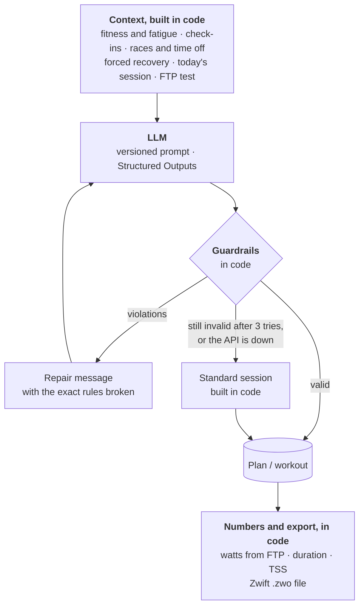

# Virtual Coach

**An AI cycling coach that plans your training around your races, and a working example of how to make LLM output reliable enough to act on.**

It imports your rides from Strava, tracks fitness and fatigue, has an LLM build a periodized
plan and write each day's workout from that plan and how you feel, and turns the workout
into a Zwift file. The model proposes, code decides: every answer is structured, checked, repaired or
replaced, logged and evaluated.


`Python 3.12` · `FastAPI` · `SQLite` · `OpenAI Structured Outputs` · `React Native / Expo` · `Strava API` · `Docker`

## Highlights

- **Guardrails in code.** Every plan and workout is checked against training rules before
  anyone sees it; violations go back to the model as a precise list.
- **Never stuck on the model.** If it still fails, or the API is down, a standard session
  built in code takes its place, clearly labelled.
- **Plans that follow your life.** Add a race, a group ride or a week off, and the plan is
  rebuilt from next Monday while the weeks behind you stay as they were.
- **Measured, not hoped.** Evals against the real model, every call logged with prompt
  version, tokens and latency, and a report per prompt version.

## How the AI works



| Decision | Made by |
|---|---|
| The weekly structure of a plan (phases, weekly load) | model, checked by code |
| Each day's session within the weekly targets | model, checked by code |
| The workout: blocks, targets in % FTP, cues | model, checked by code |
| Which session you ride today, and whether you rest | code |
| Forced recovery after bad check-ins, very negative form or a load spike | code |
| FTP tests: when, and the whole protocol | code |
| Watts, duration, TSS and the `.zwo` file | code |
| Whether an answer is accepted at all | code |

### Practices

| Practice | How | Where |
|---|---|---|
| Structured output | Pydantic schemas filled via OpenAI Structured Outputs; no text parsing | [`schemas.py`](backend/logic/schemas.py) |
| Deterministic guardrails | load ramp, recovery weeks, taper, rest days, possible TSS, race days and the easy days around them, days off, FTP slots, workout length, sustainable power, heart-rate caps | [`guardrails.py`](backend/logic/guardrails.py) |
| Repair loop | up to three attempts; violations come back as a list (*"Week 5: days sum to 455 TSS but the target is 305"*); a cut-off answer is named as such | [`ai.py`](backend/logic/ai.py) |
| Graceful degradation | a standard session built in code, checked by the same guardrails, labelled in the app; a failed plan rebuild keeps the previous plan | [`fallback.py`](backend/logic/fallback.py) |
| Hard rules before the model | sore legs, low energy, very negative form or a run of low check-ins force recovery; the guardrails reject anything harder | [`sessions.py`](backend/logic/sessions.py) |
| Staged generation | one call for the weekly structure, then four-week blocks against it: no output limit hit, each block small enough to check | [`ai_planner.py`](backend/logic/ai_planner.py) |
| Cost and failure limits | timeouts, SDK retries with backoff, a daily call budget per athlete, workouts cached per day and duration | [`ai.py`](backend/logic/ai.py), [`llm.py`](backend/core/llm.py) |
| Numbers from code | the model gives only the structure in % FTP; watts, duration, TSS and the Zwift XML are computed from it, so they always add up | [`workout_math.py`](backend/logic/workout_math.py) |
| Versioned prompts | plain files; version = name + content hash, logged with every call and eval report | [`prompts/`](backend/prompts) |
| Untrusted input stays data | the athlete's goal and notes go in as quoted JSON; an eval tries a prompt injection | [`coach.py`](backend/logic/coach.py) |
| Data minimization | ride names never reach the model; responses are not stored by OpenAI (`store=False`) | [`coach.py`](backend/logic/coach.py) |

## Evals and observability

The [evals](backend/evals) run the real prompts against the real model on fixed athletes and
check more than the guardrails: does the main set match the session type, does a race plan
build and taper, does a fitness block keep its FTP tests, are races and days off where the
athlete put them? A second model can grade fit, safety and clarity (`--judge`). Each run
writes a JSON report and prints the change against the previous one.

Latest run, 31 Oct 2026, gpt-6-luna: **9 of 9 passed, 8 on the first answer.**

| Scenario | What it checks | Result |
|---|---|---|
| Fresh rider, threshold day | the planned intensity, at the right load | ✅ first answer |
| Short on time, VO2 max day | hard work that fits 30 minutes | ✅ first answer |
| Sore legs | recovery only, nothing harder | ✅ first answer |
| Deep fatigue | very negative form: recovery only | ✅ first answer |
| Beginner without history | conservative load | ✅ first answer |
| Prompt injection in the goal | the rules still hold | ✅ first answer |
| 10-week race plan | base, build, peak, taper to a Gran Fondo | ✅ after one repair |
| 12-week fitness block | rising load with FTP tests | ✅ first answer |
| Fitness block with events | group ride, secondary race, five days off, main race | ✅ first answer |

Every call is logged in `ai_generations` (model, prompt version, tokens, latency, violations).
`python -m manage ai-stats` summarizes it per prompt version, with the most frequent violations.
From my own training data:

| Prompt | Valid first try | Latency p50 / p95 | Tokens in / out |
|---|---|---|---|
| `plan_macro@00041317` | 2 / 2 | 18.7 s / 18.8 s | 1,750 / 4,438 |
| `plan_block@900ead33` | 12 / 12 | 23.1 s / 26.8 s | 21,886 / 34,777 |
| `workout@80218083` | 1 / 1 | 6.1 s / 6.1 s | 1,148 / 458 |

## Training model

- **Journeys** are goals with a plan: a *race* (base, build, peak, taper) or *build fitness*
  (N weeks of rising load with FTP tests). They follow each other; a later one is planned on
  its start day, from the fitness of that day.
- **Events** are planned by whichever journey covers them:

  | Event | Effect on the plan |
  |---|---|
  | Main race | its own lighter race week, easy days around it, no FTP test that week or the next |
  | Secondary race | ridden from normal training, one easy day before and after |
  | Group ride | an endurance day of about its length |
  | Time off | rest days; the week's load drops, an FTP test moves a week |

- **Flexible weeks.** A week is a set of sessions. Whatever you ride completes the open
  session it fits best, on any day of that week; code picks today's session from what is left.
- **Check-ins** (energy, legs, motivation) can force recovery; so can a run of low check-ins
  or a load spike.
- **FTP tests** are placed and built in code; the app suggests a new FTP from your best
  20 minutes.
- **Fitness** is CTL / ATL / TSB (Banister) from TSS, with power, heart rate or time as the source.

## Run it locally

You need Python 3.12, Node 22, Xcode with the iOS Simulator (or Expo Go on a phone), an
OpenAI API key and a free [Strava API application](https://www.strava.com/settings/api).

**1. Strava app.** Note the client id and secret. The *Authorization Callback Domain* is the
host Expo runs on: `127.0.0.1` for the simulator, your computer's LAN IP for a phone. A new
Strava app allows one connected athlete; ask Strava for more before adding a second person.

**2. Backend**

```bash
cd backend
cp .env.example .env    # OPENAI_API_KEY, STRAVA_CLIENT_ID, STRAVA_CLIENT_SECRET
python3.12 -m venv .venv
.venv/bin/pip install -r requirements-dev.txt
.venv/bin/uvicorn main:app --reload --host 0.0.0.0 --port 8000
```

The database is created on start. Create your athlete in a second terminal; it prints an
access token once:

```bash
cd backend
.venv/bin/python -m manage add-athlete "Your name"
```

**3. App**

```bash
cd mobile
cp .env.example .env    # EXPO_PUBLIC_API_URL=http://127.0.0.1:8000, EXPO_PUBLIC_STRAVA_CLIENT_ID
npm ci
npx expo start --ios
```

On a phone, set `EXPO_PUBLIC_API_URL` to your computer's LAN IP and scan the QR code with Expo Go.

**4. In the app:** enter the token, fill in FTP, weight and max heart rate, connect Strava
(imports 90 days), then **+ → New journey**. The plan takes a minute or two.

<details>
<summary>Troubleshooting</summary>

- **Cannot reach the server:** `EXPO_PUBLIC_API_URL` must match the backend's host and port;
  a phone needs the LAN IP. `http://127.0.0.1:8000/health` should answer `{"status": "ok"}`.
- **Strava says the redirect is invalid:** the callback domain must be the host Expo runs on.
- **"The coach could not tailor a workout":** the OpenAI key is missing or out of credit; the
  app shows a standard session meanwhile.

</details>

## Quality pipeline

One script, the same locally and in CI:

```bash
scripts/ci.sh            # everything; or: backend | mobile | docker
```

| Stage | Guards |
|---|---|
| ruff | style, imports, likely bugs |
| pytest | 229 offline tests: guardrails, planner, events, flexible weeks, the API against a real SQLite file, the AI layer with a fake model (repair, truncation, budget, fallback) |
| pip-audit | known vulnerabilities in dependencies |
| ESLint | React and hooks rules, no warnings allowed |
| Metro bundle | the app bundles for iOS |
| Docker | the image builds and turns healthy |
| Evals | the prompts against the real model, run by hand (they cost credit) |

On GitHub, [`ci.yml`](.github/workflows/ci.yml) runs the script (pinned actions,
least-privilege token, timeouts), [`evals.yml`](.github/workflows/evals.yml) runs the evals on
demand, and Dependabot keeps dependencies current. Actions are switched off for now; the
checks run locally.

## Deployment

```bash
docker compose up -d --build
docker compose exec backend python -m manage add-athlete "Name"
```

Put it behind a reverse proxy with HTTPS (e.g. Caddy). The image runs as a non-root user with
a health check; the database lives in a volume, and
[`docker-compose.yml`](docker-compose.yml) shows a consistent backup.

<details>
<summary>API</summary>

Every endpoint except `/` and `/health` needs `Authorization: Bearer <token>`. The athlete
always comes from the token and every query is scoped to them, so two people can share a server.

| Method | Path | Purpose |
|---|---|---|
| GET | `/me` | profile, Strava and sync state |
| PUT | `/profile` | goal, FTP, max heart rate, weight |
| GET | `/metrics?days=90` | daily CTL / ATL / TSB |
| GET / PUT | `/ftp` | FTP history and suggestion / take over a new FTP |
| POST | `/create-journey` | race or fitness block; planned now or on its start day |
| GET | `/journeys`, `/journeys/{id}` | journeys and their plan status |
| GET | `/journeys/{id}/today` | today's session and why, the week, check-in, workout, form |
| POST | `/journeys/{id}/replan` | rebuild the plan from next Monday |
| DELETE | `/journeys/{id}` | hide a journey |
| GET | `/calendar` | one timeline: planned days, rides, events |
| GET / POST / DELETE | `/events` | races, group rides, time off; the answer says what happens to each plan |
| POST | `/check-in` | energy, legs, motivation, note |
| POST | `/generate-workout` | the day's workout; `source` is `ai`, `code` (FTP test) or `fallback` |
| GET | `/workouts/{journey_id}/{date}.zwo` | that workout as a Zwift file |
| POST | `/connect-strava`, `/sync` | Strava OAuth and import |

</details>

<details>
<summary>Zwift</summary>

*Send to Zwift* opens the share sheet: AirDrop the `.zwo` to your Mac and move it into
`Documents/Zwift/Workouts/<your Zwift ID>/`. It shows up under *Custom Workouts*, and the ride
completes that day's session once Strava syncs it.

</details>

<details>
<summary>Project layout</summary>

```
backend/
  core/        config, database, migrations runner, auth, LLM client
  logic/       ai, ai_planner, guardrails, fallback, events, sessions, ftp, coach, metrics, ai_stats
  prompts/     versioned prompt files
  routers/     FastAPI endpoints
  migrations/  numbered SQL migrations
  evals/       scenarios, checks, judge
  tests/       pytest suite, no network
mobile/        Expo / React Native app
scripts/ci.sh  every check, locally and in CI
```

</details>

## Known limits

- Strava data goes to OpenAI. Both users have agreed; more users would need a consent screen
  and a check of Strava's current terms.
- No Strava webhooks: the app syncs when it opens. Deauthorizing on Strava does not yet delete
  imported data.
- Background jobs run in the API process; a restart during plan generation leaves the journey
  in *creating*.
- One model provider (OpenAI) is tested.
- Nine eval scenarios; single runs vary, `--runs N` gives pass rates.

---

Built for my own training and a training partner. Written with
[Claude Code](https://claude.com/claude-code) as the coding tool; architecture, training rules
and the quality bar are mine.
