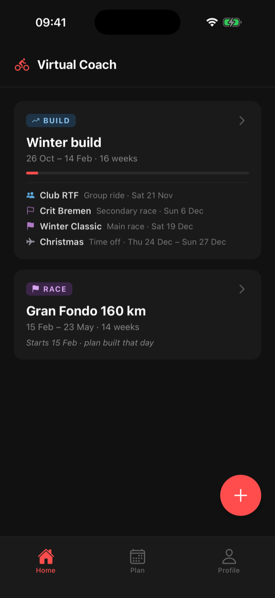
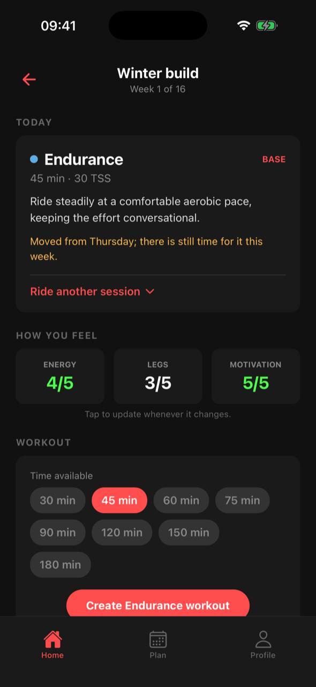
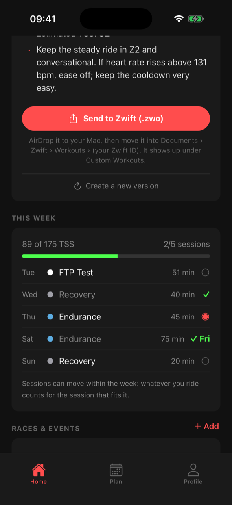
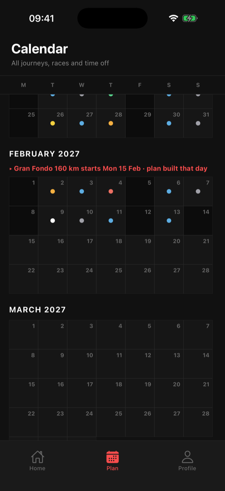
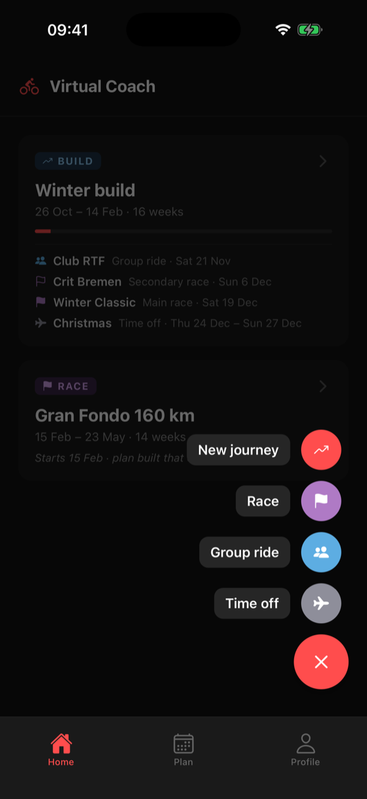
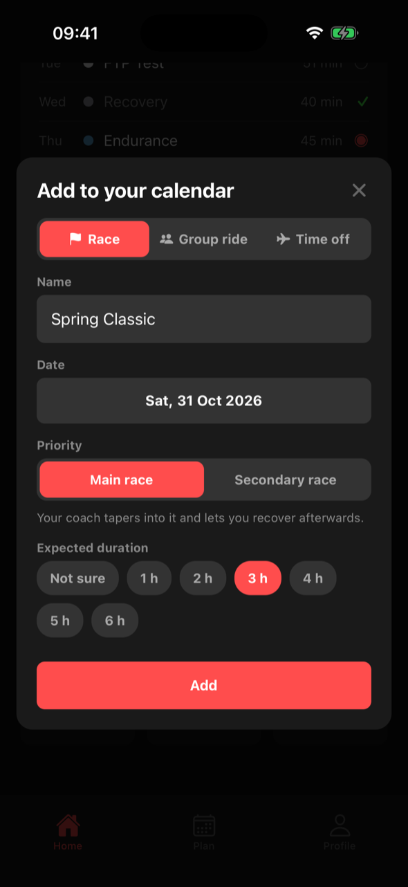
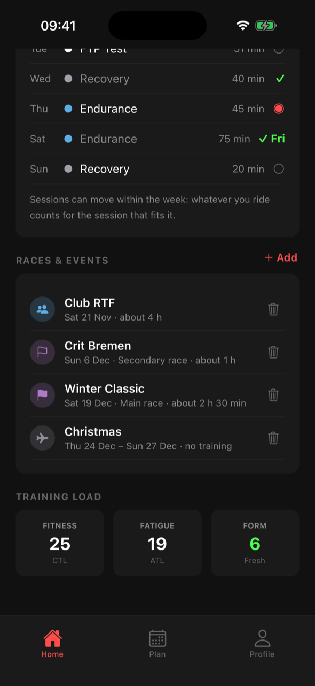
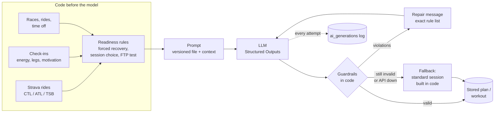

# Virtual Coach

An AI cycling coach for indoor training. It imports rides from Strava, tracks fitness and
fatigue, lets an LLM build a periodized plan around your races and holidays, and writes each
day's workout from the plan, how you feel and what you actually rode. Workouts go to Zwift as
`.zwo` files.

The interesting part is not that an LLM writes training plans, but how the app makes that
reliable: **the model proposes, code decides.** Every answer is structured, checked by
deterministic guardrails and repaired or replaced before anyone sees it, and every call is
logged and evaluated.

<table>
  <tr>
    <td></td>
    <td></td>
    <td></td>
    <td></td>
  </tr>
  <tr>
    <td>Journeys with their races, rides and breaks</td>
    <td>Today's session, chosen in code</td>
    <td>The coach's workout, one tap to Zwift</td>
    <td>One calendar over all journeys</td>
  </tr>
  <tr>
    <td></td>
    <td></td>
    <td></td>
    <td></td>
  </tr>
  <tr>
    <td>One plus for journeys and events</td>
    <td>A main race: the plan tapers to it</td>
    <td>Flexible week, and the journey's events</td>
    <td></td>
  </tr>
</table>

Built for my own winter training and a training partner; not a hosted service.

## Contents

- [The AI pipeline](#the-ai-pipeline)
- [Evals and observability](#evals-and-observability)
- [Training model](#training-model)
- [Run it locally](#run-it-locally)
- [Quality pipeline](#quality-pipeline)
- [Deployment](#deployment)
- [API](#api) · [Zwift](#zwift) · [Project layout](#project-layout) · [Known limits](#known-limits)

## The AI pipeline



**What the model decides, and what it never decides**

| The model writes | Code decides |
|---|---|
| the weekly structure of a plan (phases, weekly load) | which session you ride today, and whether you rest |
| each day's session within the weekly targets | forced recovery from check-ins, form and load spikes |
| the workout: blocks, targets as % FTP, cues | FTP tests: when, and the whole protocol |
| | watts, duration, TSS and the `.zwo` file (computed from the structure) |
| | whether any answer is accepted at all |

**Practices, and where they live**

1. **Structured outputs, not parsed text.** Plans and workouts are Pydantic schemas
   ([`logic/schemas.py`](backend/logic/schemas.py)) filled via OpenAI Structured Outputs.
2. **Deterministic guardrails** ([`logic/guardrails.py`](backend/logic/guardrails.py)). Every
   answer is checked in code: load ramp between weeks, recovery weeks, taper, rest days,
   physically possible TSS, race days and the easy days around them, days off, FTP test slots,
   workout length within the time you have, sustainable power, heart-rate caps.
3. **Repair loop** ([`logic/ai.py`](backend/logic/ai.py)). Violations go back to the model as a
   precise list ("Week 5: days sum to 455 TSS but the target is 305"). An answer cut off at the
   output limit is named as such, so the model shortens instead of guessing.
4. **Graceful degradation** ([`logic/fallback.py`](backend/logic/fallback.py)). When the model
   still fails, or the API is down, the athlete gets the planned session as a standard interval
   set built in code, checked by the same guardrails and labelled in the app, with a button to
   ask the coach again. A plan generation that fails keeps the previous plan.
5. **Hard rules before the model** ([`logic/sessions.py`](backend/logic/sessions.py)). Sore
   legs, low energy, very negative form or a run of low check-ins force a recovery session;
   the model is told so, and the guardrails reject anything harder.
6. **Staged generation** ([`logic/ai_planner.py`](backend/logic/ai_planner.py)). One call for the
   weekly structure, then the days in four-week blocks against those targets: long plans never
   hit the output limit, and each block is small enough to check and repair. A plan rebuilt
   after a race was added keeps the weeks already behind the athlete and only plans the rest.
7. **Cost and failure limits.** Timeouts and SDK retries with backoff for rate limits and
   server errors; at most three attempts per generation; a daily call budget per athlete
   (`AI_DAILY_CALL_LIMIT`), beyond which workouts fall back to standard sessions; workouts
   cached per day, session and duration.
8. **Versioned prompts** ([`backend/prompts`](backend/prompts)). Plain files; the version
   is the file name plus a content hash, logged with every call and every eval report.
9. **Untrusted input stays data.** The athlete's goal and notes are passed as quoted JSON
   strings, and the prompts say so; an eval scenario tries a prompt injection through the goal.
10. **Data minimization.** Ride names never reach the model, and OpenAI does not store the
    responses (`store=False`).

## Evals and observability

**Evals** ([`backend/evals`](backend/evals)) run the real prompts against the real model on fixed
athlete scenarios and check more than the guardrails: does the main set match the planned
session type, is the load right for the time available, does a race plan start near current
fitness, build and taper, does a fitness block keep its FTP tests and enough quality work, are
races, group rides and days off where the athlete put them? Optionally a second model grades
fit, safety and clarity (`--judge`). Each run writes a JSON report with models and prompt
versions and prints the change against the previous report.

Latest run (31 Oct 2026, gpt-6-luna, one run per scenario): **9/9 passed, 8/9 valid on the first answer.**

| Scenario | What it checks | Result | Calls | Tokens |
|---|---|---|---|---|
| fresh_intermediate_threshold_day | a threshold day for a rested rider | passed, first answer | 1 | 1,804 |
| short_on_time_vo2_day | VO2 max work squeezed into little time | passed, first answer | 1 | 2,213 |
| sore_legs_forces_recovery | sore legs: recovery only, nothing harder | passed, first answer | 1 | 1,644 |
| deep_fatigue_by_tsb | very negative form: recovery only | passed, first answer | 1 | 1,717 |
| beginner_no_history | no ride history, conservative load | passed, first answer | 1 | 1,587 |
| goal_text_tries_prompt_injection | the goal text tries to override the rules | passed, first answer | 1 | 1,551 |
| plan_race_10_weeks | base, build, peak, taper to a Gran Fondo | passed after one repair | 5 | 19,995 |
| plan_build_12_weeks | rising load with FTP tests over a winter | passed, first answer | 4 | 16,048 |
| plan_build_with_events | a group ride, a secondary race, five days off and a main race inside a fitness block | passed, first answer | 4 | 20,890 |

"First answer" means the model's first answer already passed every guardrail; otherwise the
repair loop fixed it. A plan takes one call for the weekly structure plus one per four-week
block; plans need repairs more often than workouts (the weekly load sums are strict), which is
exactly what the loop is for.

**Observability.** Every attempt lands in `ai_generations` (model, prompt version, tokens,
latency, violations). `python -m manage ai-stats` turns it into a report per prompt version
(excerpt from my own training data):

```
plan_block  plan_block@900ead33  generations   12  valid first try   12/12  calls   12  latency p50  23088 ms  p95  26814 ms  tokens  21886 in  34777 out
plan_macro  plan_macro@00041317  generations    2  valid first try    2/2   calls    2  latency p50  18700 ms  p95  18847 ms  tokens   1750 in   4438 out
workout     workout@80218083     generations    1  valid first try    1/1   calls    1  latency p50   6119 ms  p95   6119 ms  tokens   1148 in    458 out
```

The three most frequent violations per prompt are listed under each line (numbers folded, so
"Week 7: 455 TSS" and "Week 3: 210 TSS" count as one problem).

## Training model

- **Journeys.** A goal with a plan: *race* (base, build, peak, taper to an event) or *build
  fitness* (N weeks of rising load with FTP tests, e.g. a winter on Zwift). Journeys follow each
  other and never overlap. One that starts later is *scheduled*: its plan is generated on its
  start day from the fitness and FTP of that day. A plan starting right after a race opens easy.
- **Races and events** ([`logic/events.py`](backend/logic/events.py)), added with the plus and
  planned by whichever journey covers their date:
  - *main race*: its own lighter Race week, easy days around it, no FTP test that week or the next;
  - *secondary race*: ridden from normal training, one easy day before and after;
  - *group ride*: an endurance day of about the given length;
  - *time off*: rest days; the week's load drops, an FTP test in the way moves a week later.

  Adding or removing one rebuilds an active plan from next Monday; within the current week the
  day's suggestion follows the event, and sessions on days off drop out instead of counting as missed.
- **Calendar weeks.** Monday to Sunday; a plan started mid-week gets a short first week.
- **Flexible weeks** ([`logic/sessions.py`](backend/logic/sessions.py)). A week is a set of
  sessions with suggested days. Whatever you ride completes the open session it fits best (a
  hard ride the quality session, a long ride the long ride), on any day of that week.
- **What to ride today** is chosen in code: today's session if it suits you, otherwise an
  overdue key session, never an intense one the day after a hard ride, a rest day only when the
  week still has room. You can always pick another one.
- **Check in any time** (energy, legs, motivation, a note). Low energy or legs force recovery;
  several low check-ins in a row, heavy legs for days or a load spike (ATL far above CTL) rule
  out hard sessions before a single bad day would show it.
- **FTP tests** ([`logic/ftp.py`](backend/logic/ftp.py)): placed by code, always the same protocol
  (warmup, openers, 20 minutes all out in free-ride mode). The best 20-minute power of every ride
  is computed from the power stream; the app suggests the new FTP (0.95 × 20-minute power).
- **Fitness model.** CTL / ATL / TSB (Banister) from TSS, with power-based TSS when a power meter
  is present and heart-rate or time-based estimates otherwise.

## Run it locally

You need **Python 3.12**, **Node 22**, **Xcode** with the iOS Simulator (or Expo Go on a phone),
an **OpenAI API key** and a **Strava API application** (free; created in step 1).

**1. Strava.** Create an application at <https://www.strava.com/settings/api> and note the
client id and secret. The *Authorization Callback Domain* is the host of the redirect URI the
app uses: in Expo Go that is `exp://<metro host>:8081/--/strava`, so `127.0.0.1` for the
simulator and your computer's LAN IP for a phone. A new Strava application allows one connected
athlete; ask Strava for more capacity before adding a second person.

**2. Backend**

```bash
cd backend
cp .env.example .env                  # OPENAI_API_KEY, STRAVA_CLIENT_ID, STRAVA_CLIENT_SECRET
python3.12 -m venv .venv
.venv/bin/pip install -r requirements-dev.txt
.venv/bin/uvicorn main:app --reload --host 0.0.0.0 --port 8000
```

The database (`backend/data/coach.db`) is created and migrated on start. In a second terminal,
create your athlete; the command prints an access token once:

```bash
cd backend
.venv/bin/python -m manage add-athlete "Your name"
```

Check that it runs: <http://127.0.0.1:8000/health> answers `{"status": "ok"}`.

**3. App**

```bash
cd mobile
cp .env.example .env                  # EXPO_PUBLIC_API_URL=http://127.0.0.1:8000 and the Strava client id
npm ci
npx expo start --ios                  # opens the iOS Simulator; or scan the QR code with Expo Go
```

On a phone, `EXPO_PUBLIC_API_URL` must be your computer's LAN IP (`http://192.168.x.y:8000`).

**4. First steps in the app.** Enter the access token, fill in the profile (FTP, weight, max
heart rate), connect Strava (it imports the last 90 days), then tap **+ → New journey**. The
plan takes one to two minutes; add races or time off with **+** at any time.

**Troubleshooting.** *Cannot reach the server*: the app's `EXPO_PUBLIC_API_URL` and the
backend's host and port must match, and a phone needs the LAN IP. *Strava says the redirect is
invalid*: the callback domain from step 1 must be the host Expo runs on. *The coach could not tailor a
workout*: the OpenAI key is missing or out of credit; the app shows a standard session meanwhile.

## Quality pipeline

One script runs every check, locally and in CI alike:

```bash
scripts/ci.sh             # everything
scripts/ci.sh backend     # ruff, pytest (offline, the model is faked), pip-audit
scripts/ci.sh mobile      # ESLint (no warnings allowed), full iOS bundle with Metro
scripts/ci.sh docker      # build the backend image, start it, wait for /health
```

| Stage | What it guards |
|---|---|
| `ruff` | style, imports, likely bugs (pyflakes, bugbear, pyupgrade) |
| `pytest` | 229 tests: guardrails, planner, events, flexible weeks, the API end to end against a real SQLite file, the AI layer with a fake model (repair loop, truncation, budget, fallback) |
| `pip-audit` | known vulnerabilities in the runtime dependencies |
| ESLint | React and hooks rules for the app |
| Metro bundle | the app actually bundles, including import casing that only fails on Linux |
| Docker | the production image builds and becomes healthy |
| Evals | the prompts against the real model; manual (they cost API credit) |

On GitHub, [`ci.yml`](.github/workflows/ci.yml) runs the script on every push and pull request
(least-privilege token, pinned action versions, concurrency and timeouts),
[`evals.yml`](.github/workflows/evals.yml) runs the evals on demand and uploads the report, and
Dependabot keeps pip, npm and the actions up to date. Actions are currently switched off for
this repository; the checks run locally.

## Deployment

`docker compose up -d --build` on a small server behind a reverse proxy with HTTPS (for example
Caddy: `coach.example.com { reverse_proxy 127.0.0.1:8000 }`), then
`docker compose exec backend python -m manage add-athlete "Name"`. The image runs as a non-root
user with a health check; the database lives in the `coach-data` volume, and
[`docker-compose.yml`](docker-compose.yml) shows how to take a consistent backup.

## API

All endpoints except `/` and `/health` require `Authorization: Bearer <athlete token>`. The
athlete always comes from the token; request bodies never carry an id, and every query is
scoped to that athlete, so two people can share one server.

| Method | Path | Purpose |
|---|---|---|
| GET | `/me` | profile, Strava and sync state |
| PUT | `/profile` | goal, FTP, max heart rate, weight |
| GET | `/metrics?days=90` | daily CTL / ATL / TSB |
| GET / PUT | `/ftp` | FTP history and suggestion / take over a new FTP |
| POST | `/create-journey` | race (with `race_date`) or build (with `weeks`); planned now, or on its start day |
| GET | `/journeys`, `/journeys/{id}` | journeys and their plan status |
| GET | `/journeys/{id}/today` | today's session and why, this week, check-in, warning signs, workout, form |
| POST | `/journeys/{id}/replan` | rebuild the plan from next Monday (also: retry a failed rebuild) |
| DELETE | `/journeys/{id}` | hide a journey (data stays) |
| GET | `/calendar` | one timeline over all journeys: planned days, rides, events |
| GET / POST | `/events` | races (main or secondary), group rides, time off; the response says what happens to each plan |
| DELETE | `/events/{id}` | remove one; plans adapt the same way |
| POST | `/check-in` | energy, legs, motivation, note |
| POST | `/generate-workout` | the workout for a session; cached per day, session and duration; `source` is `ai`, `code` (FTP test) or `fallback` |
| GET | `/workouts/{journey_id}/{date}.zwo` | that day's workout as a Zwift file |
| POST | `/connect-strava`, `/sync` | Strava OAuth and import |

## Zwift

*Send to Zwift (.zwo)* opens the share sheet: AirDrop the file to the Mac and move it into
`Documents/Zwift/Workouts/<your Zwift ID>/`. Zwift lists it under *Custom Workouts* on the next
start. The ride then completes that day's session when Strava syncs it.

## Project layout

```
backend/
  core/         config, database and migrations runner, auth, dates
  logic/        ai.py (structured calls, repair, budget, logging), ai_planner.py, guardrails.py,
                fallback.py, events.py, sessions.py, ftp.py, coach.py, metrics.py, ai_stats.py
  prompts/      versioned prompt files
  routers/      FastAPI endpoints
  migrations/   numbered SQL migrations
  evals/        scenarios, checks, judge, reports
  tests/        pytest suite (no network)
mobile/         Expo / React Native app
scripts/ci.sh   every check, locally and in CI
docs/           screenshots
```

## Known limits

- Strava data reaches OpenAI. Strava's API agreement requires the user's explicit consent for
  sharing with third parties; both users here know and agree. More users would need a consent
  screen and a check of Strava's current AI terms first.
- No Strava webhooks: the app syncs when it opens. Deauthorizing on Strava does not yet delete
  the imported data.
- Background jobs run inside the API process; a restart during plan generation leaves the
  journey in *creating*.
- One model provider (OpenAI); the call layer is small enough to swap, but only OpenAI is tested.
- The eval set is small (nine scenarios) and each run varies; `--runs N` gives pass rates.

---

Built with [Claude Code](https://claude.com/claude-code) as the coding tool: architecture,
training rules and the quality bar are mine, the code was written under that direction.
