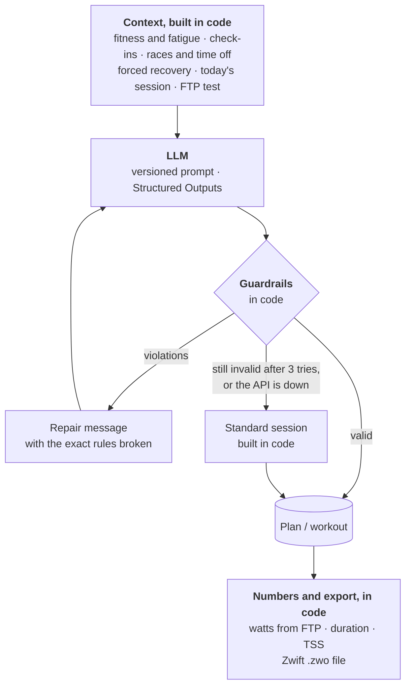

# Virtual Coach

**Your own AI cycling coach. Tell it what you are training for, and it plans every week up to
that day, writes today's workout and puts it on Zwift.**


Most training apps give you a plan and leave it at that. Real life does not stick to the plan:
you get invited to a club ride, a race pops up in spring, you are away for Christmas, or you
just wake up with heavy legs. Virtual Coach plans around all of that. It reads your rides from
Strava, knows how fit and how tired you are, and adjusts the plan when something changes.

You run it yourself, with your own Strava account and your own OpenAI key. Your rides and
plans stay in a database on your own machine; the only services it talks to are Strava and
OpenAI.

## What you can do with it

**Train for a race, or just get fitter.** Give it a race date and it builds a plan with base,
build, peak and taper. Or tell it you want to get fitter over the next twelve weeks, and it
raises the load step by step, with FTP tests along the way. When one goal ends, the next one
can start straight away, planned from the fitness you have by then.

**Put your life into the calendar.** Add a race, a group ride or a holiday with one tap. A main
race gets a lighter week and easy days around it. A smaller race is ridden out of normal
training. A group ride becomes an endurance day of about its length, and on days off there is simply
no training. The plan is rebuilt from next Monday, and everything before that stays as it
was.

**Ride what fits today.** A week is a set of sessions, not a fixed timetable. Missed Tuesday's
intervals? Ride them on Thursday. Whatever you ride counts for the session it fits best, and
the app suggests what to ride today from what is left. You can always pick something else.

**Say how you feel.** Rate your energy, legs and motivation whenever you like. Sore legs or a
bad day turn the session into recovery, and so do several poor days in a row or a sudden jump
in training load, before you end up overtrained.

**Get a workout made for today.** The coach writes the session for the time you have, whether
that is 30 minutes or three hours: warm-up, main set, cool-down, targets in watts and a few
words on how to ride it. One tap sends it to Zwift.

**See where you stand.** Fitness, fatigue and form are tracked from every ride, with power data
when you have a power meter and heart rate otherwise. After an FTP test, or a ride that shows
you have got stronger, the app suggests a new FTP.

## Set it up for yourself

You need a Mac with Xcode and the iOS Simulator, or an iPhone with Expo Go. Plus Python 3.12,
Node 22, an [OpenAI API key](https://platform.openai.com/api-keys) and a free
[Strava API application](https://www.strava.com/settings/api). The app has been tested on iOS
only.

**1. Create the Strava app.** Note its client id and secret. As *Authorization Callback
Domain*, enter the host Expo runs on: `127.0.0.1` for the simulator, your computer's LAN IP for
a phone. A new Strava app allows one connected athlete, which is you.

**2. Start the backend.**

```bash
cd backend
cp .env.example .env    # add OPENAI_API_KEY, STRAVA_CLIENT_ID, STRAVA_CLIENT_SECRET
python3.12 -m venv .venv
.venv/bin/pip install -r requirements-dev.txt
.venv/bin/uvicorn main:app --reload --host 0.0.0.0 --port 8000
```

The database is created on the first start. In a second terminal, create your athlete. The
command prints your access token once, so keep it:

```bash
cd backend
.venv/bin/python -m manage add-athlete "Your name"
```

**3. Start the app.**

```bash
cd mobile
cp .env.example .env    # EXPO_PUBLIC_API_URL=http://127.0.0.1:8000, EXPO_PUBLIC_STRAVA_CLIENT_ID
npm ci
npx expo start --ios
```

On an iPhone, point `EXPO_PUBLIC_API_URL` at your computer's LAN IP and scan the QR code with
Expo Go.

**4. Get going.** Enter your token, fill in FTP, weight and max heart rate, and connect Strava.
It imports your last 90 days of riding. Then tap **+ → New journey** and choose a race or a
fitness goal. The first plan takes a minute or two.

To get a workout into Zwift, tap *Send to Zwift*, AirDrop the `.zwo` file to your Mac and move
it into `Documents/Zwift/Workouts/<your Zwift ID>/`. Zwift lists it under *Custom Workouts*,
and once Strava has the ride, it counts for that day.

To use the app away from home, run the backend on a small server instead (see
[Deployment](#deployment)).

<details>
<summary>Troubleshooting</summary>

- **The app cannot reach the server.** `EXPO_PUBLIC_API_URL` has to match the backend's host
  and port, and a phone needs the LAN IP. `http://127.0.0.1:8000/health` should answer
  `{"status": "ok"}`.
- **Strava says the redirect is invalid.** The callback domain must be the host Expo runs on.
- **"The coach could not tailor a workout."** The OpenAI key is missing or out of credit. The
  app gives you a standard session in the meantime.

</details>

## Why you can trust the plan

Getting a language model to write a training plan is easy. Getting one you can actually ride is
harder. A plan can read perfectly well and still be wrong: the days of a week add up to far
more load than the week was meant to have, hard sessions sit back to back, or the taper is no
easier than the weeks before it. Nothing in the text gives that away. Even in the last eval
run, one of the model's answers for the race plan failed the checks and had to be repaired.

So the model only does the part that needs judgment: how a plan is shaped and what a session
looks like. Everything that can be computed or checked is plain code, and nothing the model
returns reaches you before that code has checked it.



Before the model is called at all, code has already decided a lot. It works out fitness and
fatigue from your ride history, reads your latest check-in and picks today's session. If your
legs are sore, your form is deep in the negative or the load has jumped, it decides on
recovery, and the model is told so instead of being asked. FTP tests are placed and built in
code too, because a test only means something if it is the same protocol every time.

The model then answers through
[Structured Outputs](https://platform.openai.com/docs/guides/structured-outputs) into Pydantic
schemas ([`schemas.py`](backend/logic/schemas.py)), so there is no text to parse. What comes
back is checked by [`guardrails.py`](backend/logic/guardrails.py): how fast the load ramps up
from week to week, recovery weeks, the taper, rest days, whether a day's TSS is physically
possible, the easy days around a race, days off, the slots for FTP tests, and for workouts the
length, the power you can sustain and heart-rate caps. When something breaks a rule, the model
gets the exact list back ("Week 5: days sum to 455 TSS but the target is 305") and tries again,
up to three times ([`ai.py`](backend/logic/ai.py)). An answer that was cut off at the output
limit is reported as exactly that, so the model shortens it rather than guessing what went
wrong.

If the third attempt fails too, or OpenAI is unreachable, you still get a workout:
[`fallback.py`](backend/logic/fallback.py) builds a standard session of the planned type, say
3 x 10 minutes of sweet spot, fitted to your time and checked by the same guardrails. The app
labels it as a standard session and offers to ask the coach again. A plan rebuild that fails
keeps the old plan.

The model also never produces a number that can be calculated. It describes a workout in
percent of FTP, and [`workout_math.py`](backend/logic/workout_math.py) turns that into watts,
duration, TSS and the Zwift file. The TSS you see in the app is always the TSS of the file you
ride.

Plans are generated in two steps ([`ai_planner.py`](backend/logic/ai_planner.py)): one call for
the shape of the whole plan, week by week, then the days in blocks of four weeks against those
targets. A 16-week plan in one answer runs into the output limit, and a four-week block is
small enough to check and repair on its own. When you add a race to a running plan, only the
weeks from next Monday on are planned again.

A few smaller things that matter once you rely on it:

- The OpenAI client has a timeout and retries with backoff ([`llm.py`](backend/core/llm.py)),
  and every athlete has a daily call budget. Workouts are cached per day and duration, so
  opening the app twice costs nothing.
- Prompts are plain files in [`prompts/`](backend/prompts). Their version is the file name plus
  a hash of the content, and it is stored with every call and every eval report.
- What you type, like your goal or a note, goes into the prompt as a quoted JSON string, and
  one eval tries a prompt injection through the goal. Ride names never reach the model, and
  responses are sent with `store=False`.

## Evals and observability

The guardrails only catch what is clearly wrong. Whether a workout actually fits the day is
checked by the [evals](backend/evals), which run the real prompts against the real model on a
set of made-up athletes. They check whether the main set matches the planned session type,
whether a race plan builds up and tapers, whether a fitness block keeps its FTP tests, and
whether races and days off end up where the athlete put them. Optionally a second model grades
fit, safety and clarity. Every run writes a JSON report and compares itself with the previous
one.

The last run (31 October 2026, gpt-6-luna) passed all nine scenarios. Eight were valid on the
first answer; the 10-week race plan needed one repair.

| Scenario | What it checks | Result |
|---|---|---|
| Fresh rider, threshold day | the planned intensity, at the right load | ✅ first answer |
| Short on time, VO2 max day | hard work that fits 30 minutes | ✅ first answer |
| Sore legs | recovery only, nothing harder | ✅ first answer |
| Deep fatigue | very negative form: recovery only | ✅ first answer |
| Beginner without history | conservative load | ✅ first answer |
| Prompt injection in the goal | the rules still hold | ✅ first answer |
| 10-week race plan | base, build, peak, taper to a Gran Fondo | ✅ after one repair |
| 12-week fitness block | rising load with FTP tests | ✅ first answer |
| Fitness block with events | group ride, secondary race, five days off, main race | ✅ first answer |

In normal use every call lands in the `ai_generations` table with model, prompt version,
tokens, latency and any rule violations. `python -m manage ai-stats` sums that up per prompt
version and lists the violations that come up most often, so a prompt change shows quickly
whether it made things better or worse. From real use so far:

| Prompt | Valid first try | Latency p50 / p95 | Tokens in / out |
|---|---|---|---|
| `plan_macro@00041317` | 2 / 2 | 18.7 s / 18.8 s | 1,750 / 4,438 |
| `plan_block@900ead33` | 12 / 12 | 23.1 s / 26.8 s | 21,886 / 34,777 |
| `workout@80218083` | 1 / 1 | 6.1 s / 6.1 s | 1,148 / 458 |

## Checks

All checks live in one script, so they run the same locally and in CI:

```bash
scripts/ci.sh            # everything; or just backend, mobile or docker
```

For the backend that is ruff, pip-audit and 229 pytest tests that never touch the network.
They cover the guardrails, the planner, events and flexible weeks, the API against a real
SQLite file, and the AI layer with a fake model, so the repair loop, cut-off answers, the
budget and the fallback are all exercised. For the app it is ESLint with no warnings allowed
and a full iOS bundle. The last step builds the Docker image, starts it and waits for it to
report healthy. The evals are not part of it, since they cost API credit; they run by hand or
through [`evals.yml`](.github/workflows/evals.yml).

[`ci.yml`](.github/workflows/ci.yml) runs the same script on GitHub with pinned actions, a
read-only token and timeouts on every push to `main` and every pull request, and Dependabot
keeps the dependencies current.

## Deployment

```bash
docker compose up -d --build
docker compose exec backend python -m manage add-athlete "Name"
```

Put it behind a reverse proxy with HTTPS, Caddy for example, and point the app's
`EXPO_PUBLIC_API_URL` at it. The image runs as a non-root user with a health check, the
database lives in a volume, and [`docker-compose.yml`](docker-compose.yml) shows how to take a
consistent backup.

<details>
<summary>API</summary>

Every endpoint except `/` and `/health` needs `Authorization: Bearer <token>`. The athlete
always comes from the token and every query is scoped to them, so a training partner can share
your server.

| Method | Path | Purpose |
|---|---|---|
| GET | `/me` | profile, Strava and sync state |
| PUT | `/profile` | goal, FTP, max heart rate, weight |
| GET | `/metrics?days=90` | daily CTL / ATL / TSB |
| GET / PUT | `/ftp` | FTP history and suggestion / take over a new FTP |
| POST | `/create-journey` | race or fitness block; planned now or on its start day |
| GET | `/journeys`, `/journeys/{id}` | journeys and their plan status |
| GET | `/journeys/{id}/today` | today's session and why, the week, check-in, workout, form |
| POST | `/journeys/{id}/replan` | rebuild the plan from next Monday |
| DELETE | `/journeys/{id}` | hide a journey |
| GET | `/calendar` | one timeline: planned days, rides, events |
| GET / POST / DELETE | `/events` | races, group rides, time off; the answer says what happens to each plan |
| POST | `/check-in` | energy, legs, motivation, note |
| POST | `/generate-workout` | the day's workout; `source` is `ai`, `code` (FTP test) or `fallback` |
| GET | `/workouts/{journey_id}/{date}.zwo` | that workout as a Zwift file |
| POST | `/connect-strava`, `/sync` | Strava OAuth and import |

</details>

<details>
<summary>Project layout</summary>

```
backend/
  core/        config, database, migrations runner, auth, LLM client
  logic/       ai, ai_planner, guardrails, fallback, events, sessions, ftp, coach, metrics, ai_stats
  prompts/     versioned prompt files
  routers/     FastAPI endpoints
  migrations/  numbered SQL migrations
  evals/       scenarios, checks, judge
  tests/       pytest suite, no network
mobile/        Expo / React Native app
scripts/ci.sh  every check, locally and in CI
```

</details>

## What is missing

Your Strava data goes to OpenAI, so only connect people who have agreed to that; anything
beyond a few friends would need a proper consent screen and a look at Strava's current terms.
There are no Strava webhooks yet, so the app syncs when it opens, and disconnecting on Strava's
side does not delete the imported rides. Plan generation runs as a background task inside the
API process, so a restart in the middle leaves the journey stuck in *creating*. Only OpenAI has
been tested as a provider, only iOS as a platform, and nine eval scenarios are a small set;
single runs vary, and `--runs N` gives pass rates.

---

Built by [Louis Krause](https://linkedin.com/in/louis-krause) for his own winters on Zwift,
with [Claude Code](https://claude.com/claude-code) as the coding tool. The architecture, the
training rules and the bar for what counts as done are his.
